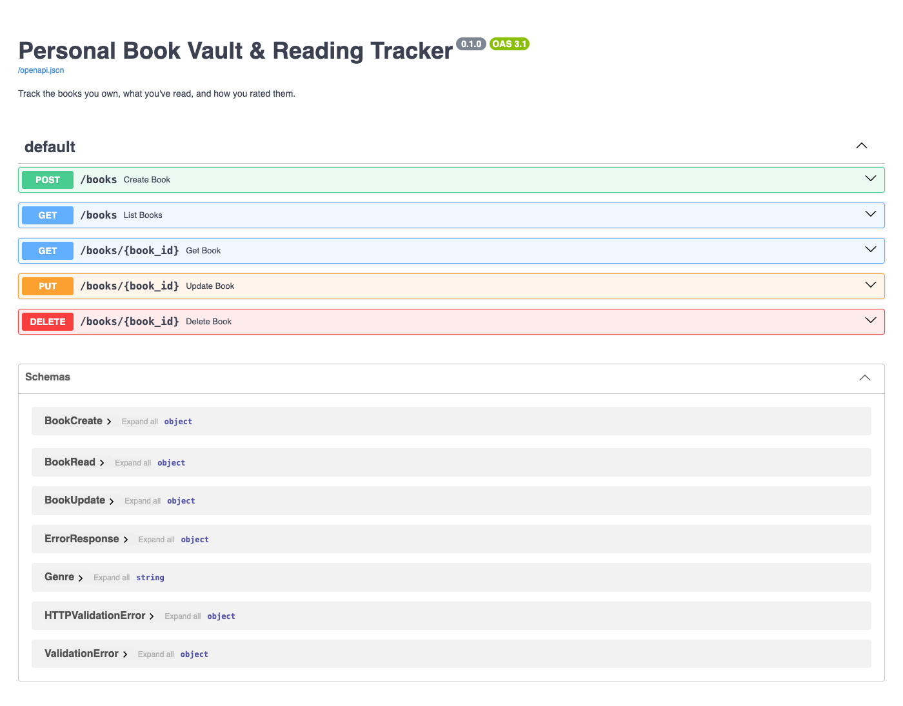
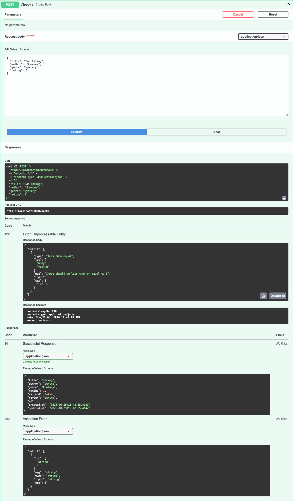
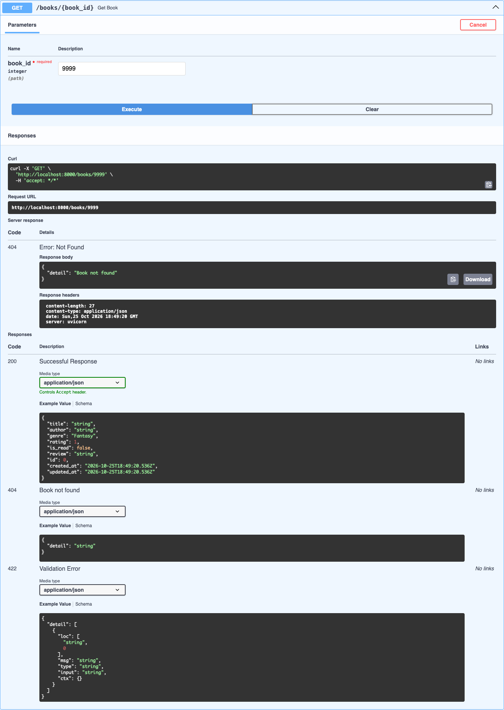
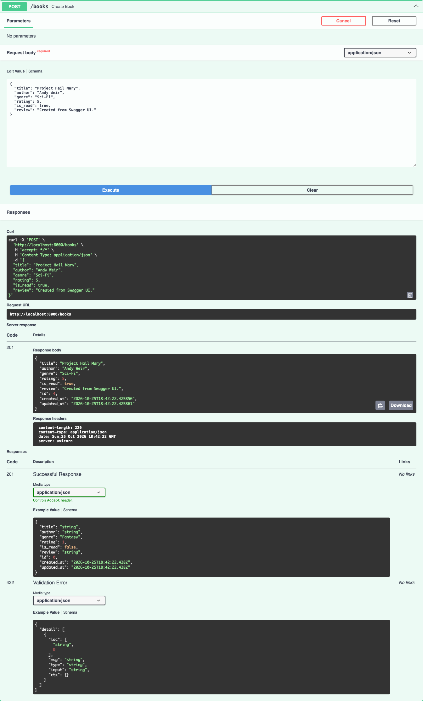
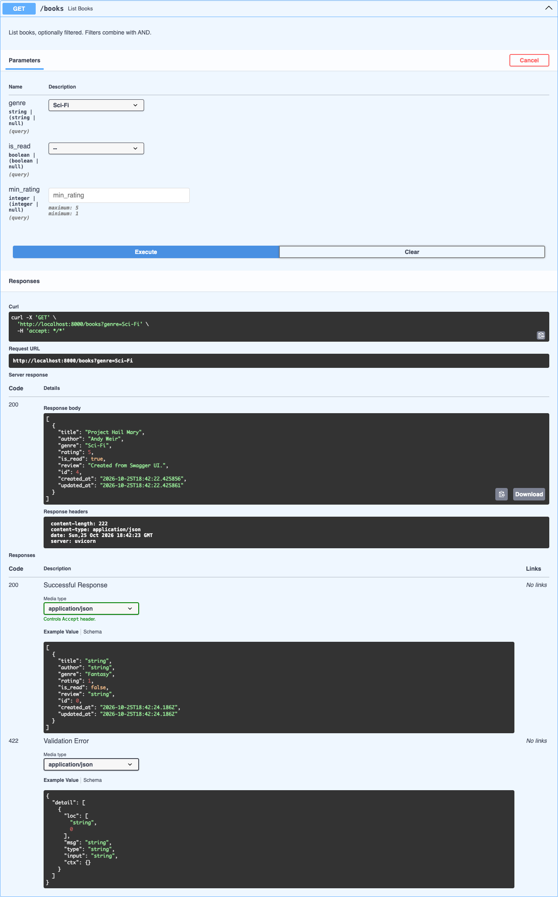
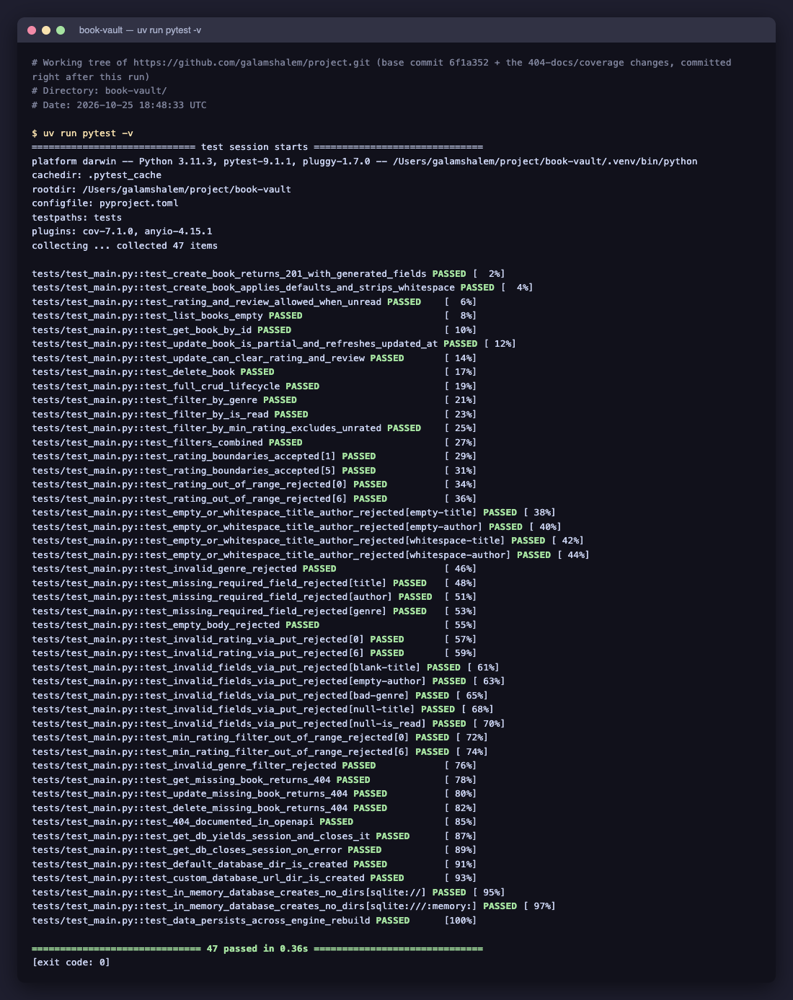
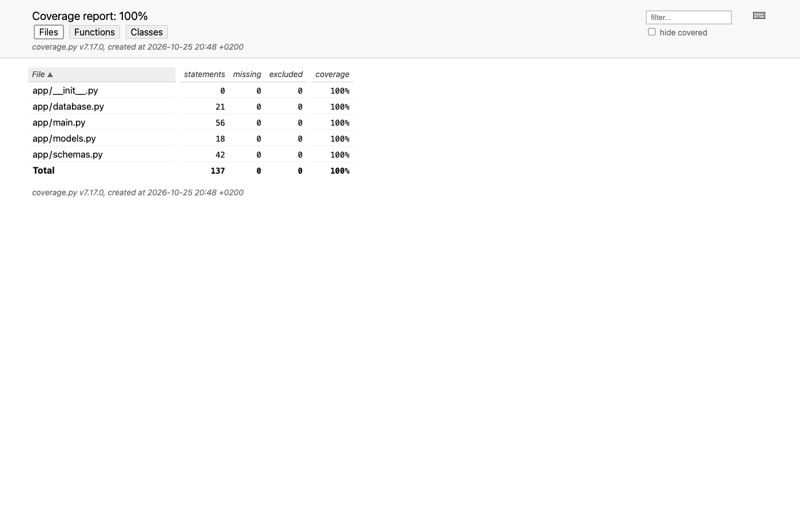

# Verification evidence: Personal Book Vault & Reading Tracker

All evidence below was produced on 2026-10-25. Text files contain the exact commands
that were run together with their full, unedited output. Screenshots were taken with
Playwright driving Google Chrome against the running server, at a 1400×900 viewport.

Evidence 01–03, 05 and 09 were refreshed after the 404 responses were documented in
OpenAPI and the `database.py` tests were added. An earlier run on a fresh clone of the
repository (commit `559d6c0`) also passed ruff and every test.

| # | Evidence | What it shows |
|---|----------|---------------|
| 01 | [01-ruff.txt](01-ruff.txt) | `uv sync` + `ruff check`: no issues |
| 02 | [02-pytest.txt](02-pytest.txt), [02-pytest.png](02-pytest.png) | Full test run: 47 passed |
| 03 | [03-coverage.txt](03-coverage.txt), [03-coverage.png](03-coverage.png) | Test coverage: 100% |
| 04 | [04-api-demo.txt](04-api-demo.txt) | Live curl session against the server, including a restart |
| 05–09 | Swagger UI screenshots | Interactive docs, with real requests executed |
| 10 | [10-docker.txt](10-docker.txt) | Docker build, run, restart and persistence |

## FastAPI

The API is a FastAPI app exposing five REST endpoints, with interactive OpenAPI docs
generated automatically at `/docs`.

## Pydantic validation

Pydantic v2 schemas reject bad input with FastAPI's standard `422` response. The
checks cover ratings outside 1–5, empty or whitespace-only titles and authors, unknown
genres, and missing fields. The demo shows rating 6 and an empty title both returning
`422` (steps 10–11 in [04-api-demo.txt](04-api-demo.txt)). A missing id returns
`404` with `{"detail": "Book not found"}`. That 404 is declared in OpenAPI, using an
`ErrorResponse` schema, on `GET`, `PUT` and `DELETE /books/{book_id}`, so Swagger lists
it as a documented response. A test checks `/openapi.json` to confirm this.

## CRUD

Books can be created (`201`), listed, fetched by id, partially updated with `PUT`
(only the fields sent are changed), and deleted (`204`, after which `GET` returns
`404`). See steps 1–3, 8–9 and 13–14 in [04-api-demo.txt](04-api-demo.txt).

## Filters

`GET /books` accepts `genre`, `is_read` and `min_rating` filters, which can be combined.
Unrated books are excluded when `min_rating` is set. See steps 5–7 in
[04-api-demo.txt](04-api-demo.txt); the combined filters are covered by the tests.

## SQLite persistence

Data is stored in a SQLite file. In the demo, the server was stopped and started
again on the same file, and the books were still there, including the `PUT` changes
and with the deleted book still gone (step 15 in [04-api-demo.txt](04-api-demo.txt)).
The test suite also checks persistence by rebuilding the database engine on a
temporary file.

## Tests

The suite has 47 pytest tests, each with an isolated in-memory database. They cover:

- CRUD
- every filter, and filter combinations
- validation `422`s and `404`s
- the documented 404s in OpenAPI
- the real `get_db` dependency
- creation of the database directory
- persistence

All 47 pass, and ruff reports no issues ([01-ruff.txt](01-ruff.txt),
[02-pytest.txt](02-pytest.txt)).

## Coverage

Coverage is 100% for every module in `app/` (137 of 137 statements), with no lines
excluded by `# pragma: no cover` ([03-coverage.txt](03-coverage.txt)). The real `get_db`
dependency is tested directly: the session is closed both after a normal request and
after an error. Directory creation is tested in a temporary directory, so the real
`data/` folder is never touched.

## Docker

The multi-stage image builds with uv and runs as a non-root user (`uid=999(app)`).
Books created in the container were still there after `docker restart`, and also
after the container was deleted and a new one started on the same named volume
([10-docker.txt](10-docker.txt)).

## Documentation

The [README](../../README.md) documents every endpoint with curl examples, along
with setup, running the server and tests, and Docker. [CLAUDE.md](../../CLAUDE.md)
lists the development commands and the project's conventions.
